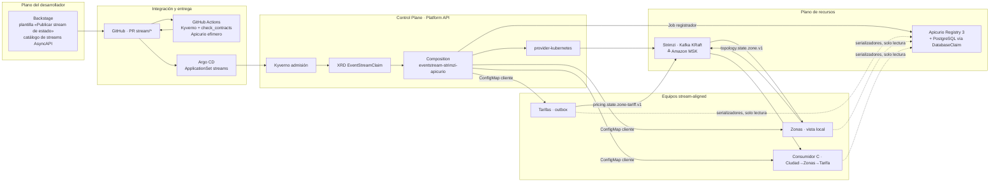

# Proyecto 2 · Sección IV · Propuesta de arquitectura: capacidad de gestión de eventos

> Responsable: Daniel. ParkGlobal es un nombre anonimizado. Esta capacidad extiende el Golden Path del P1 (`DatabaseClaim`) con un segundo producto de plataforma: **publicar un stream de estado (ECST) gobernado, en autoservicio**. El caso piloto es el de la Sección I: Tarifas → Zonas → Consumidor C.

## 1. Problema que resuelve (de la diapositiva 1 a la capacidad)

| Hallazgo (diapositivas 1-2) | Carga extraña que genera | Cómo la elimina la capacidad |
|---|---|---|
| 0 esquemas registrados; registry ocioso | Cada consumidor adivina el formato; los cambios rompen en producción | Contrato Avro obligatorio, registrado por la plataforma; `auto.register.schemas=false` |
| Sin política de compatibilidad | Coordinar despliegues a mano entre equipos y regiones | FULL_TRANSITIVE fijo; dos barreras: CI efímero y registry |
| 1 de 20 tópicos compactado | Un consumidor nuevo no puede reconstruir el estado y llama a APIs | `cleanup.policy=compact` obligatorio para `type: state` |
| Cada servicio crea sus tópicos | Decidir particiones, retención, nombres y configuración | Perfil semántico (`small`/`standard`) y nombre derivado; `auto.create.topics.enable=false` |
| Solo 2 de 42 servicios declaran sus eventos | Nadie sabe quién consume qué antes de cambiar algo | Ficha AsyncAPI en Backstage, consumidores declarados y metadatos en el registry |
| Sin outbox en varios productores | Eventos perdidos y `sleep` de 5 s | Patrón outbox en el servicio de referencia (la plantilla de outbox/CDC llega en la fase 2) |

## 2. Vista lógica por planos



## 3. Estrategia de modelado y gobierno (decisiones)

### 3.1 Granularidad de tópicos (ADR-007)
- **Un tópico de estado por entidad y un único escritor por dominio.** Kyverno (`eventstream-domain-ownership`) impide que un equipo declare un stream en un dominio ajeno. En la PoC el bus no tiene autenticación ni ACL: Kyverno controla quién **declara** un stream, no quién escribe en el tópico. En ParkGlobal la escritura se restringe con las ACLs como código que ya existen (diapositiva 2), derivadas del dueño del claim.
- **Jerarquía por referencia**: `ZoneState.cityId` y `zoneKey` enlazan Ciudad → Zona → Tarifa; cada consumidor compone su vista. Se descarta el agregado Ciudad anidado (varios escritores, mensajes enormes, particiones calientes, evolución acoplada).

### 3.2 Convenciones de nombres
| Elemento | Convención | Ejemplo |
|---|---|---|
| Tópico | `<dominio>.<tipo>.<entidad>.v<major>` (derivado por la plataforma, el equipo no lo escribe) | `pricing.state.zone-tariff.v1` |
| Subject | **TopicNameStrategy**: `<tópico>-value` | `pricing.state.zone-tariff.v1-value` |
| Clave | String sin esquema con la identidad de la entidad | `SE:4021` |
| Grupo de consumo | `team-<equipo>.<tópico>.<propósito>` (prefijo entregado por la plataforma) | `team-zonas.pricing.state.zone-tariff.v1.view` |
| ConfigMap de cliente | `<tópico>-client` en el namespace de cada equipo | `pricing.state.zone-tariff.v1-client` |

**Por qué TopicNameStrategy:** un tópico de estado transporta un único tipo (la foto de una entidad). RecordNameStrategy y TopicRecordNameStrategy sirven para varios tipos por tópico (event sourcing, comandos), un uso que la TVP excluye a propósito. Así cada tópico tiene una sola línea de evolución y una sola política.

### 3.3 Compatibilidad y evolución (ADR-005)
- **Avro + FULL_TRANSITIVE**, fijo para `type: state`; el equipo no elige.
  - **FULL** porque hay varios equipos y cuatro regiones: consumidores y productor se despliegan en cualquier orden.
  - **TRANSITIVE** porque un tópico compactado se relee desde el offset 0: el lector actual debe entender **todas** las versiones históricas, no solo la anterior.
- **Regla para el desarrollador:** campo nuevo con default → compatible. Quitar un campo sin default o cambiar su tipo → incompatible → tópico `.v<major+1>` con doble publicación y plazo de retirada.
- **Versiones inmutables:** `schemas/v1.avsc`... nunca se editan. El CI compara contra `origin/main` y rechaza cambios o borrados.
- **Dos barreras**, simétricas a Kyverno en el P1:
  1. **CI**: registry efímero con la misma imagen que producción; registra v1..vN y falla con el diagnóstico del registry (`currency at /fields/6`).
  2. **Clúster**: el Job registrador recibe 409, el claim no queda Ready y la versión nunca llega a los productores. Con `auto.register.schemas=false`, un productor con un contrato no registrado no puede serializar, y el evento queda en su outbox (no se pierde). El control vive en el serializador y en el registry: Kafka no valida los mensajes, así que un cliente que escriba bytes a mano no lo pasa. Por eso los consumidores omiten y registran un mensaje ilegible en lugar de detenerse (métrica `poison_messages_skipped`).

### 3.4 Estado con ECST y compactación
| Parámetro | Valor | Razón |
|---|---|---|
| `cleanup.policy` | `compact` | Una foto por clave: el tópico **es** el estado actual y permite relecturas |
| `min.compaction.lag.ms` | 60 000 | Un consumidor en tiempo real alcanza a ver versiones intermedias recientes |
| `delete.retention.ms` | 7 días | Tiempo que un tombstone sigue visible. Un consumidor caído más tiempo debe releer desde cero (documentado en el contrato) |
| `segment.ms` | 10 min (dev) / 1 h (staging) | Permite que la compactación actúe (el segmento activo no se compacta) |
| Particiones | `small` = 3 / `standard` = 6, fijas | Cambiarlas rompe el mapeo clave → partición y el orden por zona |
| Borrado del claim | El tópico **se conserva** (`managementPolicies` sin `Delete`) | Retirar estado de negocio es una deprecación explícita, no un efecto colateral |

Contrato de consumo (lo implementa el servicio de referencia): **upsert idempotente** si `version` es mayor que la guardada; el valor nulo es un **tombstone** que borra la clave; commit del offset después de escribir en la vista local (al menos una vez + idempotencia = efecto exactamente una vez).

### 3.5 Abstracción para el desarrollador (lo que ya no tiene que saber)

| Antes (hoy en ParkGlobal) | Con el Golden Path |
|---|---|
| Nombrar el tópico, elegir particiones, réplicas, `min.insync.replicas`, `cleanup.policy`, `segment.ms`, `delete.retention.ms` | Elige `profile: small` |
| Elegir estrategia de subject, modo de compatibilidad y llamar a la API del registry | Nada: FULL_TRANSITIVE fijo, registro hecho por la plataforma |
| Configurar serializadores (`auto.register.schemas`, `use.latest.version`), bootstrap y URL del registry | `envFrom` del ConfigMap `<tópico>-client` |
| Pedir a cada consumidor que configure lo mismo | Lo recibe en su namespace al ser declarado en `consumers` |
| Documentar el stream (o no hacerlo) | Ficha AsyncAPI en Backstage y metadatos en el registry, generados |
| Coordinar en reuniones si un cambio rompe a alguien | El CI responde en el PR con el campo exacto que rompe |

**Interfaz total: 11 campos de formulario (7 obligatorios) + el archivo de contrato.** Las decisiones de la columna izquierda dejan de ser del equipo. En el código del servicio, la configuración del bus es un `envFrom` por stream (3 líneas: `prefix`, `configMapRef` y el nombre). Ver `evidence/p2/` para las mediciones.

## 4. Flujo de control (Golden Path)

```mermaid
sequenceDiagram
  autonumber
  actor Dev as Dev (team-tarifas)
  participant BS as Backstage
  participant GH as GitHub
  participant CI as Actions + Kyverno + Apicurio efímero
  participant AR as Argo CD
  participant KY as Kyverno (admisión)
  participant XP as Crossplane (Composition)
  participant ST as Strimzi
  participant AP as Apicurio Registry
  Dev->>BS: Formulario: entidad, dominio, clave, consumidores, contrato v1
  BS->>GH: PR stream/<entidad>-state (claim + schemas/v1.avsc + AsyncAPI)
  GH->>CI: pull_request streams/**
  CI->>CI: Kyverno (dueño, dominio, PII) + estructura + inmutabilidad + FULL_TRANSITIVE
  alt incompatible o viola política
    CI-->>GH: check rojo con el diagnóstico; no se integra
  else cumple
    CI->>GH: auto-merge (sin revisión humana)
  end
  AR->>GH: sincroniza (kustomize: claim + ConfigMap del contrato)
  AR->>KY: EventStreamClaim
  KY->>XP: admitido (+ etiquetas FinOps)
  XP->>ST: Object → KafkaTopic compactado
  XP->>AP: Job: config FULL_TRANSITIVE + v1..vN + metadatos
  XP->>Dev: ConfigMap <tópico>-client (dueño y consumidores)
  XP-->>AR: Ready (topicReady ∧ contractRegistered)
  BS->>GH: descubre streams/**/catalog-info.yaml → ficha AsyncAPI
```

## 5. Equivalencia PoC / ParkGlobal

| Pieza | PoC local | ParkGlobal |
|---|---|---|
| Broker | Strimzi 1.3.0, Kafka 4.3.1 KRaft, 1 nodo | Amazon MSK, un clúster por región |
| Tópicos | `KafkaTopic` (Strimzi) vía provider-kubernetes | Composición `eventstream-msk-apicurio` con provider-kafka contra MSK (mismo XRD) |
| Registry | Apicurio 3.3.4 + PostgreSQL (CNPG vía DatabaseClaim) | Apicurio en el clúster de gestión + Aurora (DatabaseClaim → composición Aurora) |
| Identidad | Sin autenticación en el listener (PoC) | Las ACLs como código ya existen (diapositiva 2); fase 2: OAuth2/OIDC en el bus |
| Despliegue de apps de demo | `kubectl apply` (cargas de equipo) | El Golden Path de servicio de cada equipo |

## 6. Fuera de alcance (regla 80/20, casos atípicos)

Streams delta, de notificación o de comando (los gestiona el equipo con revisión del Platform Team) · PII en streams (Kyverno lo rechaza; fase 2: tokenización) · replicación entre regiones · stream processing gestionado (vista Ciudad derivada) · CDC con Debezium (fase 2: plantilla de outbox estándar) · cuotas por cliente · validación en el broker (Kafka OSS no la tiene; opción futura: proxy Kroxylicious con validación de registros).
